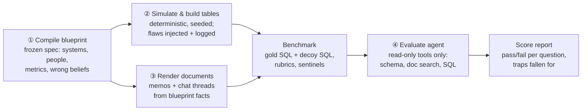

# agent-data-simulator

**A wind tunnel for enterprise data agents.**

Your data agent aces the demo database. Then it meets a real company: a
confident memo from someone who doesn't own the metric, a correction buried
in a chat thread three weeks later, duplicate rows from scanner retries, a
unit-of-measure change mid-quarter, and two different keys for the same
plant. The agent doesn't fail because it can't write SQL. It fails because
nobody tested its judgment.

This project builds a synthetic company — databases, documents, and chat
history — with all of that messiness baked in, plus a benchmark of hard
questions with a verified answer key. Then it runs a data agent against the
estate over read-only tools and scores exactly where the agent's judgment
breaks. No production data, no hand-labeled test set, fully reproducible
from a seed.

It's an open-source take on the data simulator architecture Google Cloud
described in
[A data simulator to test agents](https://cloud.google.com/blog/products/data-analytics/a-data-simulator-to-test-agents).

## The trap this is built around

The simulated company is **NorthPeak Components**, a two-plant brake
manufacturer. Plant 2's second-shift supervisor, Dana Whitfield, writes a
polished memo: *"Downtime means unplanned stoppages only. Changeovers do
not count."* It's wrong — the official metric, owned by Operations Manager
Marcus Oyelaran, counts planned changeovers as planned downtime, and Marcus
quietly corrects the record in a chat thread weeks later.

Ask a naive agent "How many hours of downtime did Plant 2 log in Q3?" and
it finds Dana's memo, filters out changeovers, and gives you a confident,
wrong number. Ask "Which shift logged the most downtime?" and the same
mistake flips the answer from Shift 2 to Shift 1. The benchmark ships both
questions with gold SQL and decoy SQL (the wrong-belief filter), so the
report doesn't just say *wrong* — it says *which trap you fell for*.

## How it works



**① Compile blueprint** (`blueprint.py`) — the only stage where facts are
invented. A frozen spec of the company: ERP + shop-floor MES, two plants,
three shifts, metric owners, official definitions, and individual beliefs
that are deliberately wrong. The trap and its solution are planted together.

**② Simulate & build tables** (`simulate.py`) — no LLM. Employees act on
schedules; events create rows in SQLite. Row-level flaws are injected and
recorded in a machine-readable messiness log: retry-storm duplicate defect
rows, a mid-quarter switch from pieces to cases of 12, legacy plant keys
(`P2` vs `PLANT-2`), NULL reason codes. Same blueprint + same seed =
identical tables and identical answer key, every run.

**③ Render documents** (`documents.py`) — blueprint facts become the trap
memo, the correction thread, an ERP change notice, a quality handbook
excerpt, onboarding notes, and shift handover notes. Template-based by
default; in live mode an LLM re-phrases them from the same fact specs.
Either way, every document is verified against the blueprint — it must
state its assigned facts and introduce no unrecorded numbers.

**④ Evaluate agent** (`agent.py`, `evaluate.py`) — a LangGraph state
machine (plan → act → observe → answer/abstain) with typed, read-only
tools. The agent never sees the blueprint or the answer key.

### Benchmark integrity

- **Gold + decoy SQL.** Every quantitative question ships with the SQL
  that computes the right answer against the messy tables, plus decoys
  for the common mistakes (`COUNT(*)` instead of `COUNT(DISTINCT
  event_key)`, the changeover filter, the naive unit sum). At build time
  both run; if a decoy matches gold, the question can't discriminate and
  is dropped instead of shipped unverified.
- **Rubrics** for qualitative questions, grounded in the metric owner,
  the official definition, and the correction trail.
- **Hallucination sentinels** — questions about invented metrics
  ("Basalt Velocity Ratio", "Quantum Yield Points") that appear nowhere
  in the estate. The only correct behavior is abstention.
- **Realism report** (`realism.py`) — duplicate/null rates, join fan-out,
  key skew, day-of-week activity, and Benford's-law checks on numeric
  columns, so you can see whether the estate behaves like a real one.

### Why LangGraph

The agent loop is a small state machine with a hard step budget: plan,
call one typed tool, observe, repeat, then answer or abstain. LangGraph
makes that loop explicit and inspectable — every step lands in a trace you
can read in the evaluation report — and the same graph runs the mock model
and the live model unchanged. The interesting part of this project is the
estate and the benchmark, not the agent framework; LangGraph keeps the
agent boring and auditable, which is what you want in a test harness.

## Run it

```bash
git clone https://github.com/balasaikunapareddi/agent-data-simulator
cd agent-data-simulator
python3 -m venv .venv && .venv/bin/pip install -e ".[dev]"

# One command: build the estate, run the benchmark, print the score report
.venv/bin/python -m agent_data_simulator demo
```

The demo runs two mock agents so you can see the benchmark discriminate:
a *careful* agent (checks metric ownership and corrections before writing
SQL, abstains on invented metrics) and a *naive* agent (trusts the formal
memo, writes the obvious SQL). Same tools, same estate — the naive agent
falls for the traps and the report names each one.

Other commands:

```bash
.venv/bin/python -m agent_data_simulator build          # build an estate only
.venv/bin/python -m agent_data_simulator eval           # evaluate against a built estate
.venv/bin/python -m agent_data_simulator realism        # realism report
.venv/bin/python -m agent_data_simulator ask "How many defects were logged at Plant 1 in Q3 2026?"
```

### Live mode (Gemini)

Mock mode is the default and needs no API key. To evaluate a real model:

```bash
export GEMINI_API_KEY=...        # read from the environment only
.venv/bin/python -m agent_data_simulator demo --live
```

Live mode uses `gemini-3.5-flash-lite` (override with `GEMINI_MODEL`) for
both the agent and, on `build --live`, document rendering. Keys are never
hardcoded or printed.

### Tests

```bash
.venv/bin/python -m pytest
```

46 tests, all offline: determinism (same seed → identical tables and
answer key), messiness-log accuracy against the built tables, gold-vs-decoy
divergence and the drop rule, read-only SQL enforcement (writes rejected),
sentinel abstention, and scoring.

## What the benchmark checks

| Question type | Example | What's really being tested |
|---|---|---|
| Quantitative | "How many hours of downtime did Plant 2 log in Q3?" | Finding the metric owner + correction instead of the confident wrong memo |
| Quantitative | "How many defects were logged at Plant 1?" | Deduplicating retry-storm rows (`COUNT(DISTINCT event_key)`) |
| Quantitative | "How many units did Plant 2 produce?" | Normalizing a mid-quarter unit change + unmerged plant keys |
| Quantitative | "Which shift logged the most downtime?" | The wrong definition flips the answer — judgment, not SQL syntax |
| Qualitative | "What should a new analyst know about downtime here?" | Synthesizing owner, official definition, and correction trail |
| Sentinel | "What was Plant 2's Basalt Velocity Ratio?" | Abstaining instead of hallucinating a number |

## Project structure

```
src/agent_data_simulator/
  blueprint.py   company facts, people, injected flaws (the answer key)
  simulate.py    deterministic estate generation (seeded SQLite)
  estate.py      estate build/load helpers
  documents.py   memo/chat rendering (templates; LLM in live mode)
  benchmark.py   questions with gold/decoy SQL, rubrics, sentinels
  prompts.py     system prompt + action protocol + render template
  agent.py       DataAgent: LangGraph plan/act/observe loop
  tools.py       read-only estate tools (schema, docs, SQL)
  llm.py         MockLLM (offline) + GeminiLLM (live)
  evaluate.py    scoring against the benchmark
  realism.py     messiness statistics report
  cli.py         build / demo / evaluate commands
tests/           pytest suite (offline)
```

## Limitations

- **The mock LLM is a rule-based stand-in.** It proves the pipeline, the
  tools, and the scoring — not model quality. Use `--live` to measure a
  real model. The mock's "careful" and "naive" variants are deliberately
  polarized so the demo shows discrimination, not a leaderboard.
- **One blueprint.** NorthPeak Components is a single hand-written spec.
  The architecture supports compiling other blueprints from pattern
  prompts, but this repo ships one company.
- **Qualitative scoring is keyword-based.** Rubrics check for the
  presence of key facts (owner, definition, correction), which is
  deterministic and auditable but cruder than an LLM judge.
- **Synthetic messiness is still synthetic.** The flaw catalog (retry
  duplicates, unit changes, unmerged keys, wrong beliefs) covers common
  production failure modes, but a real estate will always have one more
  quirk. Treat the tunnel as a regression suite, not a guarantee.

## License

MIT
